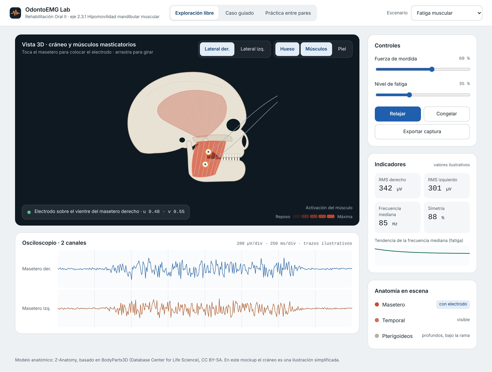

# OdontoEMG Lab

Un laboratorio virtual para aprender a hacer **electromiografía del músculo masetero** (el registro de la actividad eléctrica del músculo con electrodos sobre la piel), sin depender de los equipos del laboratorio.

Proyecto PAPIME 2027 · UNAM e IPN · materia de Rehabilitación Oral II.

## ¿Por qué existe?

Cada año hay unos 600 alumnos y solo 3 equipos de electromiografía, así que muy pocos alcanzan a practicar. Este simulador permite que cualquier alumno practique desde una computadora, tablet o celular, sin instalar nada.

## ¿Qué se puede hacer hoy?

Esta es una **primera versión de la pantalla**. Ya se puede:

- **Ver la señal del músculo** en un osciloscopio, como en el equipo real, para el masetero derecho y el izquierdo.
- **Colocar el electrodo** tocando o arrastrando sobre el músculo, y ver cómo cambia la señal si queda bien o mal colocado.
- **Mover la fuerza de mordida y la fatiga** y ver cómo responde el músculo.
- **Leer los indicadores** que se usan en clínica: la intensidad de la señal (RMS), la frecuencia mediana (que baja cuando el músculo se fatiga) y la simetría entre ambos lados.
- **Elegir un escenario**: función normal, fatiga muscular o bruxismo.
- **Congelar la señal y guardar una captura.**

**Importante:** por ahora la señal es una **aproximación** que sirve para construir y probar la pantalla. Todavía no sale del modelo fisiológico del músculo, que se conectará más adelante. Los valores de los escenarios también son provisionales y deben revisarse con el equipo clínico.

## ¿Qué falta?

| Cuándo | Qué |
| --- | --- |
| Trimestre 3 | Un cráneo en 3D con sus músculos, donde el alumno coloca el electrodo directamente |
| Trimestre 4 | Casos clínicos guiados, práctica entre compañeros y uso sin internet |
| Trimestre 5 | Ajustes después de comparar con el equipo real; versión de prueba para alumnos |

## ¿Cómo probarlo?

Abre el enlace de la versión publicada: `https://<usuario>.github.io/odontoemg-lab/`. Funciona en el navegador; no hay que instalar nada.

## ¿Cómo participar?

No hace falta saber programar. Puedes probar el simulador y dejar comentarios, por ejemplo: *"la señal en fatiga no se parece a la del equipo"* o *"este término no es el que usamos en clase"*. La guía paso a paso está en **[Cómo colaborar](CONTRIBUTING.md)**.

## Más información

- [Cómo funciona](docs/como-funciona.md): el simulador explicado en pocas palabras.
- [La pantalla](docs/pantalla.md): qué hay en cada parte y qué aprende el alumno con ella.
- [Decisiones](docs/decisiones.md): qué se decidió, por qué y qué falta decidir juntos.
- [Para desarrolladores](docs/para-desarrolladores.md): detalles técnicos para quien programe.

## Créditos

- El cráneo 3D se basará en [Z-Anatomy](https://github.com/Z-Anatomy/The-blend), un atlas anatómico libre (licencia CC BY-SA 4.0), que a su vez parte de BodyParts3D © The Database Center for Life Science (CC BY-SA 2.1 Japón).
- El código es abierto (licencia MIT, por confirmar).
