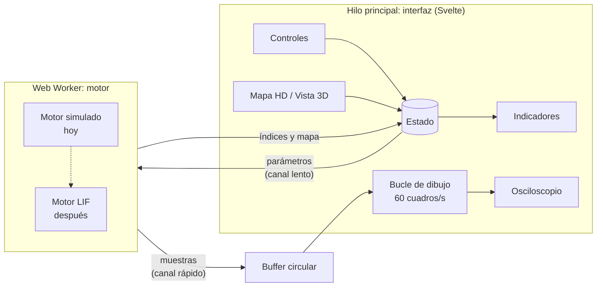

# Arquitectura

**En una frase:** aplicación web estática con dos capas separadas. Un **motor** calcula la señal en un Web Worker y una **interfaz** solo la muestra. El motor de hoy es simulado; el fisiológico lo reemplazará sin tocar la interfaz.

Nombre técnico: *arquitectura cliente en capas, con un motor de tuberías y filtros en un Web Worker, desplegada como aplicación web estática*.

## Tres reglas

1. **La interfaz no calcula.** Ninguna fórmula fisiológica vive en `src/lib/componentes/`. Si hace falta un número, lo calcula el motor.
2. **Dos canales de datos.**
   - *Lento*: lo que cambia el alumno (fuerza, fatiga, electrodo). Pasa por el estado de Svelte y llega al motor con `postMessage`.
   - *Rápido*: la señal, 2 000 muestras por segundo por canal. Va directo a un buffer circular que el osciloscopio lee en cada cuadro. **Nunca pasa por Svelte**, porque eso trabaría la app en tablets.
3. **Un solo contrato.** Interfaz y motor solo se comunican con los mensajes de [`src/lib/worker/contrato.ts`](../src/lib/worker/contrato.ts). Si ese archivo no cambia, se puede cambiar el motor sin tocar la interfaz.

## El contrato

| Dirección | Mensaje | Contenido |
| --- | --- | --- |
| Interfaz → motor | `parametros` | fuerza y fatiga (0 a 1), contrayendo (sí/no), electrodo (u, v de 0 a 1) |
| Interfaz → motor | `pausar` / `reanudar` | congelar la señal |
| Motor → interfaz | `bloque` | muestras en µV de cada canal, cada 50 ms |
| Motor → interfaz | `indices` | RMS por lado (µV), frecuencia mediana (Hz), simetría (%), 4 veces por segundo |
| Motor → interfaz | `mapa` | 64 amplitudes de la rejilla 8 × 8, 4 veces por segundo |

Frecuencia de muestreo: **2 000 Hz**.

## Qué es provisional

| Pieza | Hoy | Después |
| --- | --- | --- |
| Motor | Ruido filtrado: la amplitud sube con la fuerza, la frecuencia mediana baja con la fatiga (de ~120 a ~75 Hz) | Pool de motoneuronas LIF → espigas → MUAPs → rejilla HD → electrodo |
| Posición del electrodo | Una gaussiana sobre el vientre muscular, con caída sobre la zona de inervación | Modelo de conductor de volumen |
| Valores de escenarios | Estimados | Validados contra el equipo de captura (actividad 1.5) |
| Envío de muestras | `postMessage` con transferencia | `SharedArrayBuffer` si el hosting permite las cabeceras COOP/COEP |

## Despliegue

`npm run build` genera archivos estáticos en `dist/`. Se publican en GitHub Pages con el flujo `.github/workflows/publicar.yml`. No hay servidor ni base de datos.
