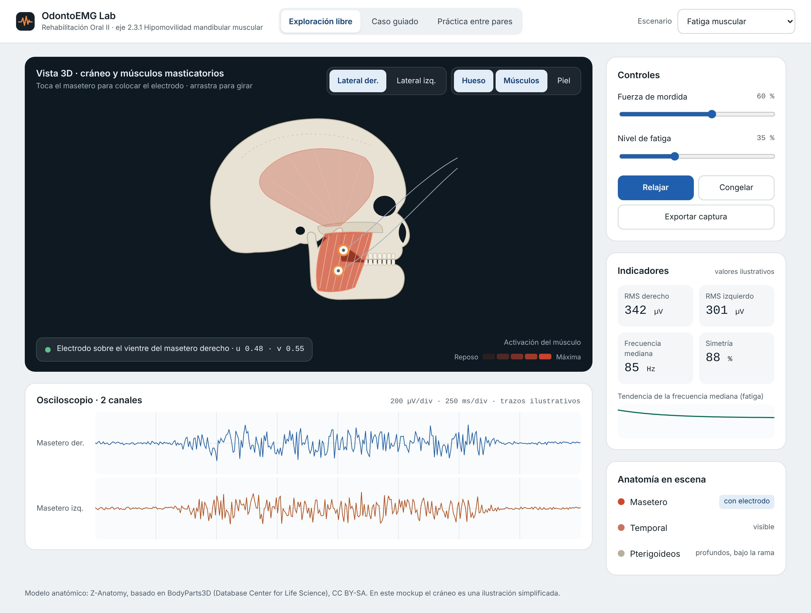

# La pantalla

*La imagen muestra el diseño final, con el cráneo en 3D. En la versión actual, en lugar del cráneo aparece un mapa del músculo.*

## Las partes y qué aprende el alumno con cada una

| Parte | Qué muestra | Qué aprende el alumno |
| --- | --- | --- |
| **Colocación del electrodo** | Un mapa del masetero que se ilumina donde hay más actividad, y el electrodo, que se mueve con el dedo | Dónde colocar el electrodo y qué pasa si queda lejos del centro del músculo |
| **Cráneo 2D** | El cráneo de frente y de cada lado, con los electrodos A y B sobre el masetero derecho y una lista que revisa la colocación | Colocar el par sobre el vientre, a la distancia correcta, paralelo a las fibras y lejos de la zona de inervación |
| **Osciloscopio** | La señal del masetero derecho e izquierdo, en tiempo real | A leer la señal como en el equipo: amplitud, reposo y contracción |
| **Controles** | Fuerza de mordida, nivel de fatiga y el botón Contraer / Relajar | Cómo cambia la señal con el esfuerzo y con el cansancio del músculo |
| **Indicadores** | Intensidad de la señal de cada lado, frecuencia mediana y simetría | A interpretar los números que se reportan en clínica |
| **Escenario** (arriba) | Función normal, fatiga muscular o bruxismo | A reconocer cada condición por su señal |

## Un ejemplo de uso

1. El alumno elige el escenario **Fatiga muscular**.
2. Coloca el electrodo en el centro del masetero y presiona **Contraer**.
3. Ve cómo la señal crece y, al subir la fatiga, cómo la frecuencia mediana baja poco a poco.
4. Mueve el electrodo hacia el borde y comprueba que la señal se debilita: así aprende por qué importa la colocación.
5. Congela la señal y guarda una captura para su reporte.

## Cómo está pensada

- **Se parece al equipo real:** escalas en microvoltios y milisegundos por división, señal que avanza de izquierda a derecha, botón para congelar.
- **Colores con un solo significado:** el azul es para lo que se puede tocar; el rojo coral, solo para la actividad del músculo.
- **Fácil de usar en tablet:** botones grandes y diseño que se acomoda a pantallas angostas.
- **Accesible:** todo se puede usar con teclado y la información no depende solo del color.
