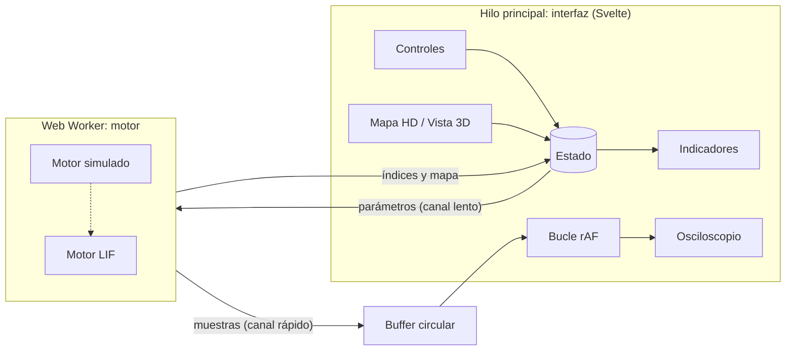

# Para desarrolladores

## Instalar y correr

Requiere [Node.js](https://nodejs.org) 20.19 o más reciente.

```bash
npm install
npm run dev      # http://localhost:5173
```

| Comando | Para qué |
| --- | --- |
| `npm run dev` | Servidor de desarrollo con recarga automática |
| `npm run check` | Revisa tipos y componentes |
| `npm run build` | Genera la versión publicable en `dist/` |

Stack: Svelte 5 (runas) + TypeScript + Vite. Canvas 2D para dibujar la señal.

## Arquitectura

Aplicación web estática en dos capas: un **motor** en un Web Worker calcula la señal y la **interfaz** solo la muestra. Nombre técnico: *arquitectura cliente en capas, con un motor de tuberías y filtros en un Web Worker*.



**Reglas:**

1. **La interfaz no calcula fisiología.** Si hace falta un número, lo calcula el motor.
2. **Dos canales.** Los parámetros pasan por el estado de Svelte y llegan al worker con `postMessage`. La señal (2 000 muestras/s por canal) va a un buffer circular que el osciloscopio lee en cada cuadro y **nunca pasa por Svelte**.
3. **Un solo contrato**, en [`src/lib/worker/contrato.ts`](../src/lib/worker/contrato.ts). Si no cambia, se puede reemplazar el motor sin tocar la interfaz.

## Contrato con el motor

| Dirección | Mensaje | Contenido |
| --- | --- | --- |
| Interfaz → motor | `parametros` | `fuerza`, `fatiga` (0–1), `contrayendo`, `electrodo {u, v}` (0–1) |
| Interfaz → motor | `pausar` / `reanudar` | Congelar |
| Motor → interfaz | `bloque` | Muestras en µV por canal, cada ~50 ms (`Float32Array` transferido) |
| Motor → interfaz | `indices` | RMS por lado (µV), frecuencia mediana (Hz), simetría (%), ~4 Hz |
| Motor → interfaz | `mapa` | 64 amplitudes de la rejilla 8×8, ~4 Hz |

Muestreo: 2 000 Hz. Motor simulado: ruido gaussiano con paso-banda de primer orden; el corte superior baja con la fatiga (frecuencia mediana de ~120 Hz a ~75 Hz); amplitud según fuerza y posición (gaussiana sobre el vientre, atenuada sobre la zona de inervación).

## Estructura

```text
src/
├── App.svelte                 pantalla principal y conexión con el motor
├── app.css                    tokens de diseño
└── lib/
    ├── componentes/           Osciloscopio, MapaHD, Vista3D, Controles, Indicadores
    ├── estado/estado.svelte.ts estado único de la interfaz
    ├── render/                dibujo en Canvas (osciloscopio, mapa HD)
    ├── worker/                contrato, puente y buffer circular
    └── motor-simulado/        generador provisional, FFT y el worker
```

## Estado

| Sección | Contenido | La modifica |
| --- | --- | --- |
| `sesion` | modo, escenario | App |
| `contraccion` | fuerza, fatiga, contrayendo | Controles |
| `electrodo` | u, v | MapaHD (después también Vista3D) |
| `visualizacion` | µV/div, congelado, vista | Osciloscopio, App |
| `indices` | último cálculo del motor | el puente |

## Reglas de trabajo

- Rama por tarea desde `main` (`interfaz/vista-3d`, `arreglo/escala`), pull request con revisión; nadie integra su propio PR.
- `npm run check` y `npm run build` deben pasar (el flujo *Verificar* lo comprueba en cada PR).
- Nombres y comentarios en español; TypeScript estricto.
- Colores y tamaños desde los tokens de `src/app.css`. Azul (`--acento`) solo para controles; coral (`--activacion`) solo para activación muscular.
- Botones de al menos 44 px; todo usable con teclado.
- Las decisiones técnicas nuevas se anotan en [`decisiones.md`](decisiones.md).

## Decisiones técnicas

| Decisión | Motivo | Descartado |
| --- | --- | --- |
| Svelte 5 + TypeScript + Vite | Ligero y rápido en tablets | React |
| Canvas 2D | Suficiente para 2 canales y 64 celdas | WebGL desde el inicio |
| `postMessage` con transferencia | GitHub Pages no permite las cabeceras COOP/COEP que exige `SharedArrayBuffer` | `SharedArrayBuffer` (se puede retomar con otro hosting) |
| Publicación en GitHub Pages con `base: './'` | Gratis y automática desde `main` | Servidor propio |

## Vista 3D (plan)

1. Blender, a partir de Z-Anatomy: cráneo, mandíbula (pivote en la ATM), masetero, temporal y pterigoideos como objetos con nombre; reducir polígonos; mapa UV del masetero alineado con la rejilla 8×8.
2. Exportar a `public/modelos/craneo-musculos.glb` con compresión Draco.
3. `Vista3D.svelte`: Three.js + `GLTFLoader`; `Raycaster` sobre `masetero_der` → la UV del toque se escribe en `estado.electrodo`.
4. Colorear el masetero según `estado.indices.rms`; cargar el componente con `import()` dinámico.
5. Sin WebGL2 → mostrar el mapa HD.

Referencias: [Three.js](https://threejs.org/docs/) · [Threlte](https://threlte.xyz/docs/learn/getting-started/introduction) · [glTF-Transform](https://gltf-transform.dev/) · [Exportar glTF desde Blender](https://docs.blender.org/manual/en/latest/addons/import_export/scene_gltf2.html)
